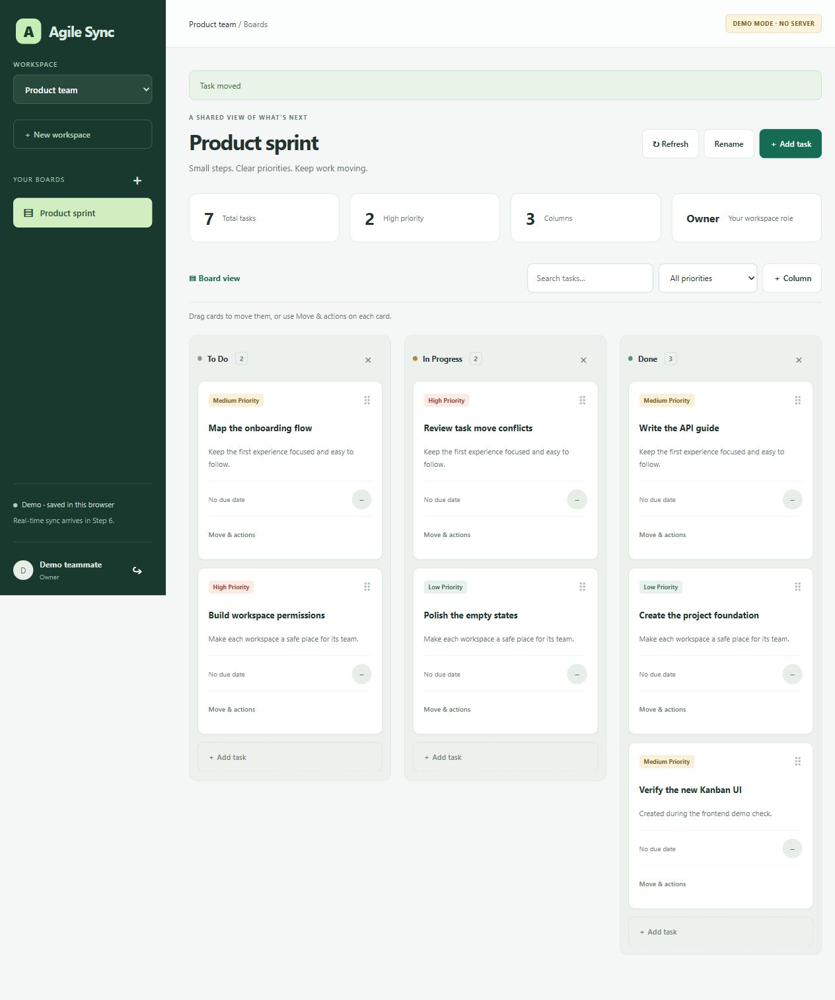

# Agile Sync

A full-stack, real-time Kanban task management application built with React, Node.js, Express, MongoDB, and Socket.IO.

Agile Sync helps teams organize work into separate workspaces, create boards, prioritize tasks, and track progress across customizable columns. Changes are synchronized between connected clients, while workspace roles control access.

## Project Preview



## Features

### Accounts and Authentication

- Register with a name, email address, and password.
- Sign in and sign out.
- Restore an existing session when returning to the application.
- Password hashing using Node.js scrypt and randomly generated salts.
- Server-side sessions stored in MongoDB.
- HttpOnly session cookies, with Secure cookies in production.
- Authentication rate limiting.
- Session expiration and logout revocation.

Passwords must contain at least 12 characters.

### Workspaces and Access Control

- Create multiple workspaces.
- Switch between workspaces from the sidebar.
- Keep boards and tasks scoped to their workspace.
- Enforce permissions on the backend.
- Support owner, admin, member, and viewer roles.

| Role | Read boards and tasks | Manage boards and tasks | Add registered members |
| --- | --- | --- | --- |
| Owner | Yes | Yes | Yes, including admins |
| Admin | Yes | Yes | Yes, as members or viewers |
| Member | Yes | Yes | No |
| Viewer | Yes | No | No |

Adding registered members is currently available through the backend API.

### Boards and Columns

- Create and switch between boards.
- Rename boards.
- Start with To Do, In Progress, and Done columns.
- Add custom columns.
- Delete columns subject to backend validation.

Board deletion and column rename/reordering are supported by the API but are not currently exposed as complete frontend controls.

### Task Management

- Create, view, edit, and delete tasks.
- Add titles and descriptions.
- Set low, medium, or high priority.
- Set an optional due date.
- Drag and drop tasks between columns.
- Reorder tasks within a column.
- Use explicit move and ordering controls as alternatives to dragging.
- Search tasks and filter by priority.

The backend also supports task assignment to workspace members; the current task editor does not include an assignee selector.

### Real-Time Synchronization

- Authenticated Socket.IO connections.
- Workspace and board subscription checks.
- Automatic updates when another connected client changes a board.
- Connection status indicators.
- Automatic resubscription and snapshot refresh after reconnecting.
- Disconnection when a session expires or is revoked.

### Conflict Handling

Board and task changes use version checks. If another client has already changed the resource, the server rejects a stale update with HTTP 409 instead of silently overwriting it.

The frontend refreshes the board after a conflict so the user can review the latest state.

### Interactive Demo

- Explore the application without MongoDB or an account.
- Work with sample boards and tasks.
- Save demo changes in browser local storage.

Demo data is local to the browser and does not synchronize between users or devices.

## Tech Stack

| Technology | Purpose |
| --- | --- |
| React 19 | Component-based frontend |
| React Hooks and Context API | Application state and shared actions |
| CSS | Responsive layout and interface styling |
| Vite 7 | Frontend development server and production build |
| Node.js | Backend JavaScript runtime |
| Express 5 | HTTP routes, middleware, and API handling |
| MongoDB | Persistent application data |
| Mongoose 9 | Schemas, indexes, validation, and database operations |
| Socket.IO 4 | Real-time client/server communication |
| Node.js crypto | Password hashing, random tokens, and token digests |
| Node.js test runner | Automated tests |
| npm workspaces | Shared dependency installation and project scripts |

## How It Works

1. A user registers or signs in through the React interface.
2. The backend verifies the credentials and creates a session in MongoDB.
3. The browser receives an HttpOnly session cookie.
4. The user selects a workspace and board.
5. The frontend retrieves a board snapshot through the REST API.
6. The browser connects to Socket.IO and subscribes to the selected workspace and board.
7. When a user changes a task or board, the backend checks permissions, validates input, and applies the database change.
8. After the change commits, the server sends a real-time notification to authorized subscribers.
9. Connected clients fetch the latest state and update their interfaces.

MongoDB transactions keep related changes consistent. Version checks protect against stale edits, and reconnect refreshes recover changes missed during a connection interruption.

During development, Vite proxies `/api` and `/socket.io` requests to the backend.

## Project Structure

```text
Agile-Sync/
├── client/
│   ├── src/
│   │   ├── App.jsx          # Main application layout
│   │   ├── components.jsx   # Forms, dialogs, and task components
│   │   ├── context.jsx      # Shared application state and actions
│   │   ├── api.js           # HTTP client
│   │   ├── realtime.js      # Socket subscriptions and recovery
│   │   ├── demo.js          # Browser-local demo
│   │   ├── main.jsx         # React entry point
│   │   └── styles.css       # Interface styling
│   ├── test/
│   ├── index.html
│   ├── vite.config.js
│   └── package.json
├── server/
│   ├── src/
│   │   ├── auth/            # Authentication and workspace access
│   │   ├── boards/          # Board/task routes and business logic
│   │   ├── db/              # Database connection and index checks
│   │   ├── models/          # Mongoose schemas
│   │   ├── http/            # Shared HTTP errors
│   │   ├── app.js           # Express application
│   │   ├── realtime.js      # Socket.IO runtime
│   │   ├── load-runner.js   # Load-test implementation
│   │   └── index.js         # Backend startup
│   ├── scripts/             # Database and load-test commands
│   ├── test/
│   ├── .env.example
│   └── package.json
├── .gitignore
├── package.json
├── package-lock.json
├── preview.png
└── README.md
```

`node_modules/`, real environment files, and generated build output are excluded from Git.

## Database Model

| Collection | Stores |
| --- | --- |
| Users | Names, email addresses, and password hashes |
| Workspaces | Workspace names, slugs, and creators |
| Memberships | User/workspace relationships and roles |
| Boards | Workspace boards and embedded columns |
| Tasks | Task content, priority, ordering, dates, and references |
| Sessions | Hashed session tokens and expiration times |

Indexes enforce unique emails, workspace slugs, and memberships. Additional indexes support board/task retrieval and automatic expiration of session records.

## Current Scope

The application implements persistent accounts, workspace roles, Kanban task management, real-time synchronization, and conflict handling.

Possible future improvements include:

- Frontend membership management.
- Task assignee controls.
- Email verification and password reset.
- Invitations.
- Membership removal and ownership transfer.
- Additional board and column management controls.
- Audit logs.
- Coordination across multiple backend instances.

## License

A license has not yet been selected for this project.
